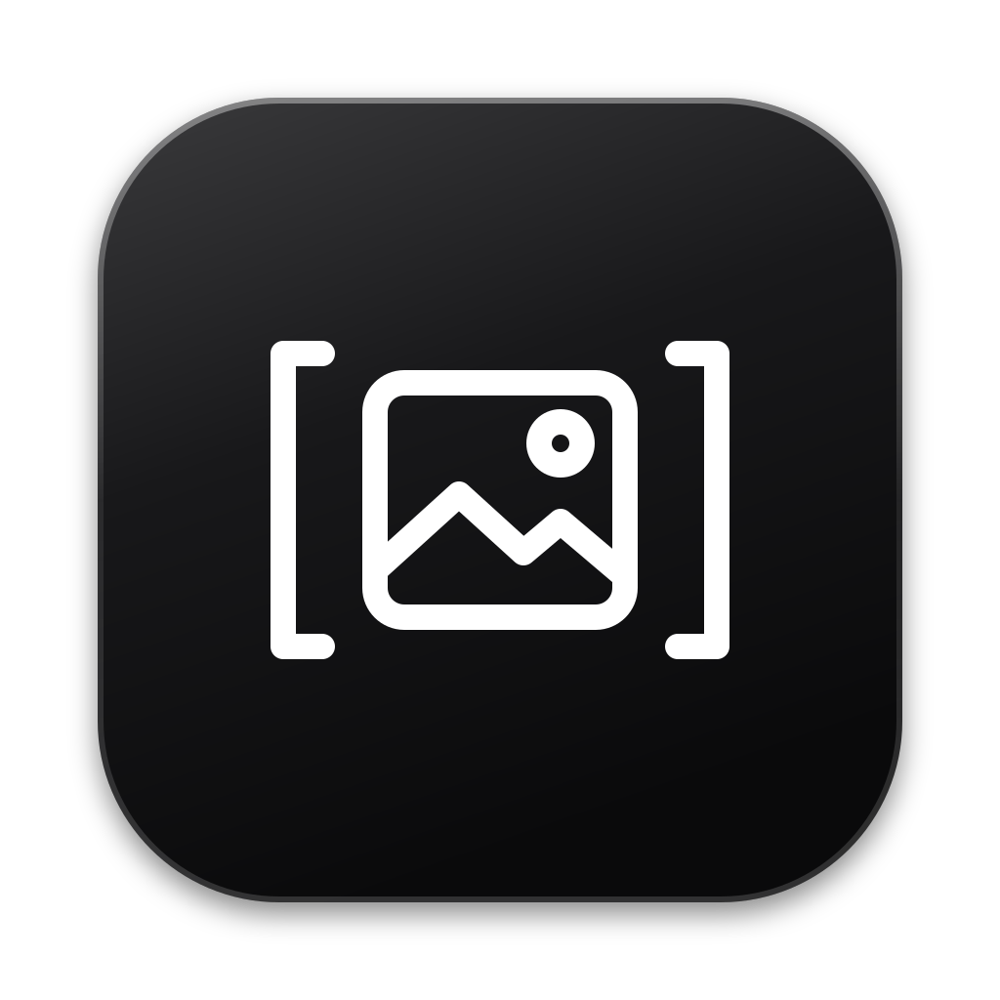
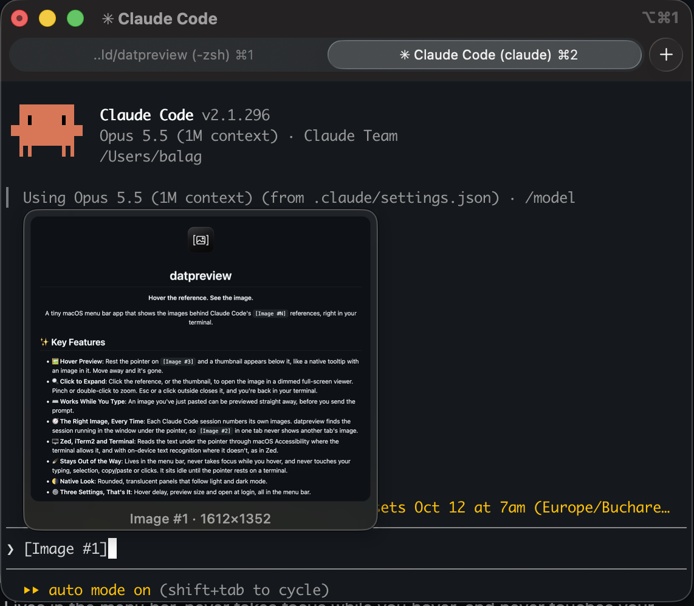

# datpreview

**Hover the reference. See the image.**

A tiny macOS menu bar app that shows the images behind Claude Code's `[Image #N]` references, right in your terminal.

## ✨ Key Features

- **🖼️ Hover Preview**: Rest the pointer on `[Image #3]` and a thumbnail appears below it, like a native tooltip with an image in it. Move away and it's gone.
- **🔍 Click to Expand**: Click the reference, or the thumbnail, to open the image in a dimmed full-screen viewer. Pinch or double-click to zoom. Esc or a click outside closes it, and you're back in your terminal.
- **⌨️ Works While You Type**: An image you've just pasted can be previewed straight away, before you send the prompt.
- **🧭 The Right Image, Every Time**: Each Claude Code session numbers its own images. datpreview finds the session running in the window under the pointer, so `[Image #2]` in one tab never shows another tab's image.
- **🖥️ Zed, iTerm2 and Terminal**: Reads the text under the pointer through macOS Accessibility where the terminal allows it, and with on-device text recognition where it doesn't, as in Zed.
- **🪶 Stays Out of the Way**: Lives in the menu bar, never takes focus while you hover, and never touches your typing, selection, copy/paste or clicks. It sits idle until the pointer rests on a terminal.
- **🌗 Native Look**: Rounded, translucent panels that follow light and dark mode.
- **⚙️ Three Settings, That's It**: Hover delay, preview size and open at login, all in the menu bar.

## ⬇️ Install

1. Download `datpreview-<version>.dmg` from Releases, open it, and drag **datpreview** into **Applications**.
2. Open datpreview. The first time, macOS may say it can't verify the developer, because the app isn't notarized. Go to **System Settings → Privacy & Security**, scroll down and click **Open Anyway**.
3. Grant the two permissions the welcome window asks for (see below), then hover over any `[Image #N]`.

Requires macOS 15.2 or later, on Apple silicon or Intel.

### Permissions

| Permission | Why | Used for |
| --- | --- | --- |
| Accessibility | Reads the text under the pointer | Terminal.app, iTerm2 |
| Screen Recording | Reads a thin strip around the pointer (about 560×56 points) and turns it into text on your Mac | Zed, which doesn't share its terminal text with macOS |

If datpreview isn't listed in either setting, click **+**, pick it from Applications, and turn it on.

## 🖱️ Viewer Shortcuts

| Key | Action |
| --- | --- |
| `Esc` / `⌘W` / `Space` | Close |
| Click outside the image | Close |
| Double-click | Zoom in / back to fit |
| Pinch | Zoom |
| `⌘+` / `⌘-` | Zoom in / out |
| `⌘0` | Back to fit |

## 🛠️ Technology Stack

- **Language**: [Swift 6](https://www.swift.org/), built with Swift Package Manager (no Xcode needed)
- **UI**: [AppKit](https://developer.apple.com/documentation/appkit), with non-activating panels for the preview and viewer
- **Text Under the Pointer**: [Accessibility API](https://developer.apple.com/documentation/applicationservices/axuielement_h)
- **Screen Strip**: [ScreenCaptureKit](https://developer.apple.com/documentation/screencapturekit)
- **Text Recognition**: [Vision](https://developer.apple.com/documentation/vision), on device
- **Open at Login**: [ServiceManagement](https://developer.apple.com/documentation/servicemanagement)

## 🔬 How It Works

### Finding the Image
- Claude Code saves each prompt, pasted images included, in its session log (`~/.claude/projects/<project>/<session>.jsonl`). A prompt with images lists their numbers, and the images follow in the same order.
- The moment you paste, Claude Code also writes the image to `/private/tmp/claude-<uid>/<project>/<session>/images/N.png`. That's where an image comes from before you've sent it.
- datpreview reads only the new part of a session log when it changes, and it remembers only where each image sits, not the images themselves.

### Finding the Session
- Every running Claude Code process notes its session in `~/.claude/sessions/<pid>.json`. datpreview follows each process up to the terminal app that runs it.
- When one terminal app runs several sessions, it compares the line around the reference with each session's prompts, and prefers the most recently active session.
- Extra Claude Code config folders such as `~/.claude-work`, and `CLAUDE_CONFIG_DIR`, are picked up too.

### Finding the Reference
- **Terminal.app and iTerm2** expose their text to Accessibility, so datpreview asks for the characters under the pointer and the exact position of `[Image #N]`.
- **Zed** exposes no terminal text at all, so datpreview captures a thin strip around the pointer and reads it with Vision's accurate text recognition, in about 50 ms.

## ⚖️ Privacy

- datpreview makes **no network connections**. No accounts, no analytics, no update checks.
- It reads Claude Code's own files on your Mac, and only to show you your own images.
- The screen strip used in Zed stays in memory just long enough to be read, and is never saved.
- Your settings are the only thing it stores.

 

**Made for terminal people. 🖼️**  
*Hover the reference. See the image.*
